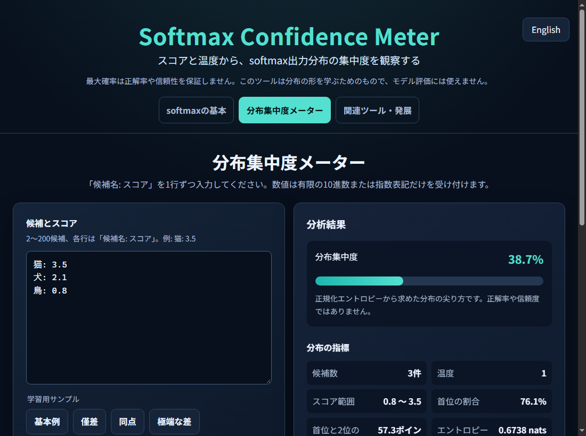
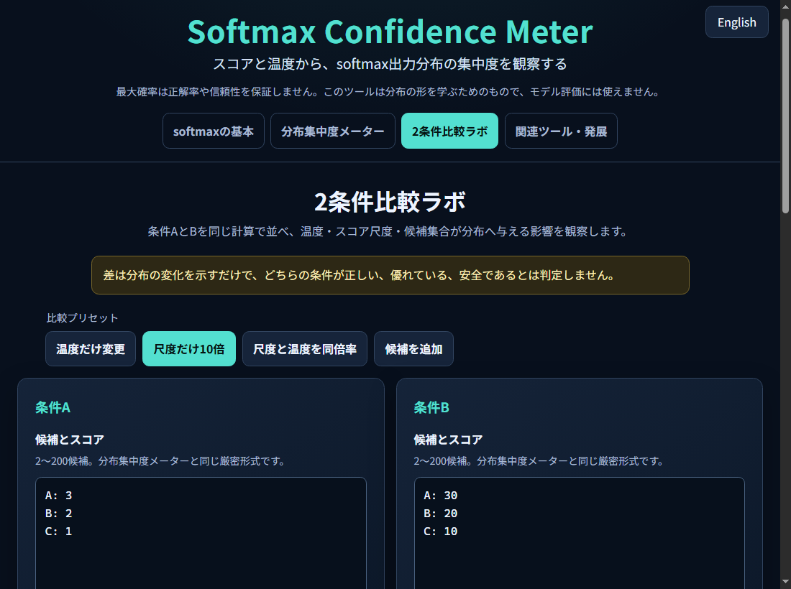
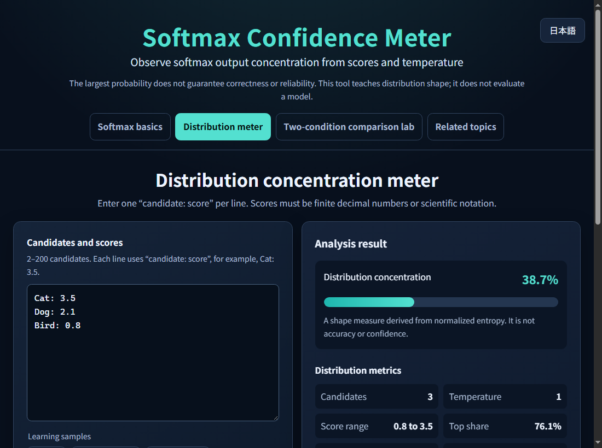
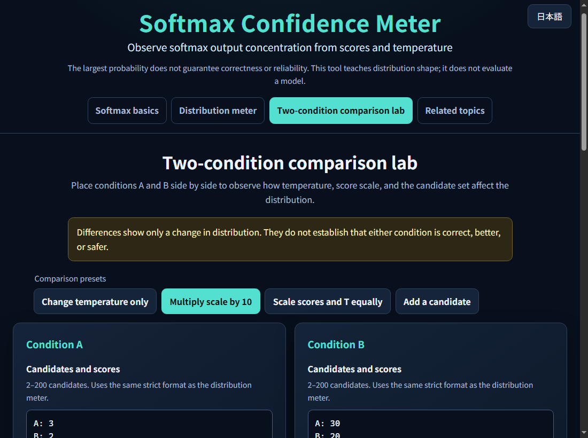

<!--
---
id: day111
slug: softmax-confidence-meter

title: "Softmax Confidence Meter"

subtitle_ja: "softmax分布集中度メーター"
subtitle_en: "Softmax Distribution Concentration Meter"

description_ja: "スコアと温度によるsoftmax出力分布の変化を、集中度・エントロピー・2条件比較で観察する学習ツール"
description_en: "A learning tool for observing how scores and temperature affect a softmax output distribution through concentration, entropy, and side-by-side comparison"

category_ja:
  - 学習支援
  - 分析・評価補助
category_en:
  - Learning Support
  - Analysis Aid

difficulty: 1

tags:
  - softmax
  - entropy
  - probability-distribution
  - calibration
  - visualization

repo_url: "https://github.com/ipusiron/softmax-confidence-meter"
demo_url: "https://ipusiron.github.io/softmax-confidence-meter/"

hub: true
---
-->

# Softmax Confidence Meter — softmax分布集中度メーター


[](https://ipusiron.github.io/softmax-confidence-meter/)

**Day111 - 生成AIで作るセキュリティツール200**

候補ごとのスコアをsoftmax分布へ変換し、温度による変化を観察するブラウザー完結型の学習ツールです。単独の分布指標に加え、2条件を並べて温度・スコア尺度・候補集合による違いを比較できます。

> [!IMPORTANT]
> ツール名に「Confidence」とありますが、表示するのは出力分布の**集中度**です。最大確率や集中度は、予測の正解率、モデルの信頼性、安全性を保証しません。

[English README](README.en.md)

## 🌐 デモページ

👉 [Softmax Confidence Meterを開く](https://ipusiron.github.io/softmax-confidence-meter/)

サーバーへの送信は行わず、入力と計算はブラウザー内で完結します。

## 📸 スクリーンショット

### 日本語表示





### English UI





## ✨ 主な機能

- `候補名: スコア`形式を厳密に検証し、不正な行を行番号付きで表示
- 最大スコアを引いてから指数関数を計算する、数値的に安定したsoftmax
- 温度`T = 0.10〜5.00`による分布の変化を即時比較
- 分布集中度、エントロピー、正規化エントロピー、首位割合、上位差を表示
- 2条件比較ラボで、候補集合・順位・実効スコア幅・集中度差・首位割合差を並べて表示
- 「温度だけ変更」「尺度だけ10倍」「尺度と温度を同倍率」「候補を追加」の4プリセット
- 上位5件に加え、省略件数と残り確率の合計を表示し、全候補も展開可能
- 基本・僅差・同点・極端な差の4種類の学習用サンプル
- 日本語・英語の画面切り替えと、両言語で同じ内容の解説
- キーボード操作、ARIAタブ、開閉可能な解説、ライブリージョンに対応
- 320px幅から利用できるモバイル優先レイアウト

## 🚀 使い方

1. 「分布集中度メーター」タブを開きます。
2. 1行に1候補ずつ、`候補名: スコア`を入力します。
3. 必要に応じて温度スライダーを調整します。
4. 「分布を計算」を押します。`Ctrl+Enter`、macOSでは`⌘+Enter`でも計算できます。
5. 集中度だけで結論を出さず、首位割合、上位差、エントロピー、全候補の分布も確認します。

2つの条件を比べる場合は「2条件比較ラボ」タブを開きます。プリセットを選ぶか、条件A・Bへ候補とスコア、`0.1〜10.0`の温度を入力して「2条件を比較」を押してください。候補集合が異なる場合は、同じ候補の前後比較として扱わず、候補の追加・削除による全体の再配分として示します。

入力例：

```text
猫: 3.5
犬: 2.1
鳥: 0.8
```

温度`T = 1`での出力は、実装の計算で次の値になります。

| 候補 | softmax出力 |
|---|---:|
| 猫 | 76.1% |
| 犬 | 18.8% |
| 鳥 | 5.1% |

## 🧾 入力仕様

- 候補数は2〜200件です。
- 入力全体は20,000文字、候補名は1件100文字までです。
- スコアは有限の10進数または指数表記です。例：`-2`、`.5`、`+1.2e-3`
- `Infinity`、`-Infinity`、`NaN`、数値の後ろに文字が続く`1junk`、コロンが複数ある`A:1:2`は拒否します。
- 候補名を省略して数値だけを入力した場合は、自動的に候補番号を表示します。
- 空行は無視します。不正な非空行は黙って捨てず、すべてエラーとして示します。

## 🧮 計算方法

候補`i`のスコアを`z_i`、温度を`T`、最大スコアを`m`とすると、softmax出力`p_i`は次の式で計算します。

```text
p_i = exp((z_i - m) / T) / Σ_j exp((z_j - m) / T)
```

最大スコアを先に引くことで、`exp(1000)`のようなオーバーフローを避けます。すべてのスコアに同じ有限値を加えても分布は変わりません。

分布集中度`C`は、自然対数を使ったエントロピー`H(p)`と候補数`n`から求めます。

```text
H(p) = -Σ_i p_i log(p_i)
C = 1 - H(p) / log(n)
```

- 全候補が均等なら`C = 0`です。
- 1候補に確率が集中するほど`C`は1に近づきます。
- スコアを同じ倍率で拡大すると、順位が同じでも分布は鋭くなります。
- スコアと温度を同じ倍率で拡大すると、分布は変わりません。

## ⚠️ 読み方と限界

softmax出力は、与えられた候補間の相対的な重みです。最大値が90%でも、その候補が90%の確率で正しいとは限りません。大きなスコア差や小さな温度だけでも、最大値は100%近くになります。

分布集中度は「分布がどれだけ尖っているか」を表します。次の内容は測定しません。

- 予測が正しいか
- モデルが確率校正されているか
- 入力が学習分布の範囲内か
- モデルや意思決定が安全か、公平か
- 候補集合に正解が含まれているか

信頼性を評価するには、正解ラベル付きの独立データを使い、精度、信頼度曲線、ECE、Brier scoreなど、目的に合う指標を別途確認してください。

## 🎯 活用例

### スコア尺度の違いを体験する

2条件比較ラボの「尺度だけ10倍」を使います。`3, 2, 1`と`30, 20, 10`は順位が同じですが、同じ温度では後者の分布がはるかに集中します。順位だけでsoftmax出力が決まらないことを、集中度差と候補別の割合で確認できます。

### 温度調整の教材にする

「温度だけ変更」を使い、同じスコアを低温と高温で並べます。低温で分布が鋭く、高温で平らになる様子を比較でき、生成や分類に温度を使う場合の直感づくりに役立ちます。

### スコア尺度と温度の同値性を確かめる

「尺度と温度を同倍率」を使うと、スコア差を5倍にしながら温度も5倍にした2条件が同じ分布になります。softmaxがスコア差と温度の比に反応することを確認できます。

### 候補追加による再配分を観察する

「候補を追加」を使うと、既存候補のスコアを変えなくても全候補の割合が変わります。候補集合が違う結果の集中度差を、同じ母集団の単純な増減として解釈できないことを学べます。

### 上位候補だけを見る危険を確認する

候補を6件以上入力し、上位5件の外側に残る確率質量を確認できます。表示上位だけで全体を代表させないための教材として使えます。

### 実装テストの期待値を作る

小規模な有限スコアを入力し、別のsoftmax実装と確率合計、順位、温度応答を比較できます。ただし、本ツール自体を暗号学的・統計学的な検証器として扱うことはできません。

## 🔗 関連ツール

- [Token Entropy Estimator](https://ipusiron.github.io/token-entropy-estimator/) — 文字列やトークン列のエントロピーを観察するツール。本ツールの候補分布のエントロピーとは対象が異なります。
- [InfoQuantity Academy](https://ipusiron.github.io/infoquantity-academy/) — 情報量とエントロピーを図解で学ぶツール。

## 🔐 セキュリティとプライバシー

- 外部ライブラリー、CDN、解析サービスを使用しません。
- 入力値はネットワークへ送信せず、ブラウザー内だけで処理します。
- 描画には`textContent`とDOM APIを使い、入力文字列をHTMLとして解釈しません。
- Content Security Policyでスクリプト・スタイル・接続先を同一オリジンに制限しています。
- 言語設定だけを`localStorage`に保存します。候補名やスコアは保存しません。
- GitHub Pagesでは任意の応答ヘッダーを設定できないため、`X-Frame-Options`によるクリックジャッキング対策は提供していません。

機密情報を扱うことを目的としたツールではありません。公開端末や共有端末では、機密性のある候補名やスコアを入力しないでください。

## 🧪 ローカル実行とテスト

ビルドや依存パッケージのインストールは不要です。`index.html`を直接開くか、任意の静的HTTPサーバーで配信できます。

Node.js 22以降で自動テストを実行します。

```bash
npm test
```

テストでは、厳密な入力解析、数値安定性、集中度、2条件比較、日英辞書、CSP・ARIA・安全なDOM描画、READMEの計算例を確認します。`npm run browser:test`では、インストール済みのMicrosoft Edgeを使ってHTTPと`file://`、4画面幅、日英切り替え、比較プリセット、XSS耐性を確認し、スクリーンショットを更新します。

## 📁 ディレクトリー構造

```text
softmax-confidence-meter/
├── .github/
│   └── workflows/
│       └── test.yml             # push・pull_request時のNode.jsテスト
├── assets/
│   ├── screenshot.png           # 日本語画面のスクリーンショット
│   ├── screenshot-en.png        # 英語画面のスクリーンショット
│   ├── screenshot-comparison.png     # 日本語の比較ラボ
│   └── screenshot-comparison-en.png  # 英語の比較ラボ
├── css/
│   └── style.css                # モバイル優先の画面スタイル
├── docs/
│   ├── SPEC.md                  # 計算・入力・非目標の仕様
│   └── UI_SPEC.md               # 画面とアクセシビリティの仕様
├── js/
│   ├── core.js                  # DOM非依存の入力解析・softmax・比較計算
│   ├── i18n.js                  # 日英メッセージと表示言語設定
│   └── main.js                  # タブ・単体分析・2条件比較・安全な結果描画
├── scripts/
│   └── browser-check.mjs        # Edgeを使うブラウザースモークテスト
├── test/
│   ├── core.test.js             # 計算コアの単体テスト
│   ├── i18n.test.js             # 日英辞書の整合性テスト
│   └── static.test.js           # HTML・JS・文書の回帰テスト
├── .gitignore                   # Git除外設定
├── .nojekyll                    # GitHub PagesのJekyll処理を無効化
├── CLAUDE.md                    # 開発時のリポジトリールール
├── LICENSE                      # MIT License
├── README.en.md                 # 英語版README
├── README.md                    # 日本語版README
├── index.html                   # アプリケーション本体
└── package.json                 # テストコマンドとNode.js要件
```

## 📄 ライセンス

MIT Licenseです。詳細は[LICENSE](LICENSE)を参照してください。

## 🛠️ このツールについて

本ツールは「生成AIで作るセキュリティツール200」プロジェクトの一環として開発されています。プロジェクトの詳細と他のツールは、[生成AIで作るセキュリティツール200](https://akademeia.info/?page_id=44607)を参照してください。
